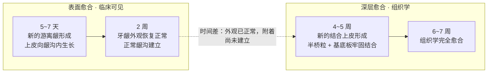

> [!quote] 牙龈切除术（gingivectomy）
> 是==用手术方法切除增生肥大的牙龈组织或后牙某些部位的中等深度牙周袋，重建牙龈的生理外形及正常的龈沟==。
> ==🟢牙龈成形术==（gingivoplasty）与牙龈切除术相似，只是其目的较单一，为修整牙龈形态，重建牙龈正常的生理外形，两者常合并使用。

## 适应证

1. ==[[牙龈纤维瘤病|牙龈纤维性增生]]、[[药物性牙龈肥大]] 等牙龈肥大增生性病损==，经牙周基础治疗后牙龈仍肥大、增生、形态不佳或存在假性牙周袋，全身健康无手术禁忌者 。
2. **后牙**区==中等深度的 [[骨上袋]]，袋底不超过 [[膜龈联合]]，[[附着龈]] 宽度足够者==。临床上主要应用于有 [[根分叉病变]] 的磨牙，==既可消除牙周袋，又可暴露根分叉区==，有利于该区域的菌斑控制。
3. ==牙龈瘤和妨碍进食的 [[妊娠期龈炎|妊娠瘤]] ==，在全身情况允许的情况下可手术（最好别）。
4. ==冠周龈组织覆盖在阻生牙面上、影响自洁==，而该阻生牙的位置基本正常，切除多余的龈组织有利于牙的萌出。

在选择适应证时要特别注意，如存在下列情况，则==🔴不是适应证==
1. 未进行牙周基础治疗，==🔴牙周组织仍存在明显炎症==。
2. 深牙周袋的袋底==🔴超过 [[膜龈联合]] ， [[附着龈]] 过窄者==如采用牙龈切除术切除袋壁来消除牙周袋，会将角化龈完全切除。
3. 牙槽骨缺损及牙槽骨形态不佳，==🔴需行骨手术者==，应采用 [[04Archives/补充卡片归档/05-牙周病学/翻瓣术]]，不适用牙龈切除术。
4. **前牙**的 [[牙周袋]]，牙龈切除术会==🔴导致牙根暴露，影响美观==。

## 手术方法

1. 麻醉：传导阻滞麻醉或局部浸润麻醉。一般多用含肾上腺素的 4% [[阿替卡因]]，也可用 2% [[利多卡因]]。尽量在手术区根方的龈颊沟部行浸润麻醉，腭侧则行切牙孔或腭大孔阻滞麻醉，避免直接注入手术切除部位，否则会影响手术切除的准确性。
2. 消毒：让患者在术前用 ==🔵0.12%[[氯己定液]] 含漱==，以清洁口腔。口腔周围皮肤用乙醇消毒，铺消毒巾。术者戴无菌手套。
3. 标定手术切口的位置：
	1. 印记镊法
	2. 探针法
4. 切口：用 15 号刀片或斧形龈刀，==从定点的根方 1~2 mm 处作切口，刀刃斜向冠方，与牙体长轴呈 45° 角切入至袋底的根方==。
5. 清创：用龈上洁治器刮除切下的边缘龈组织和邻面牙间龈组织，然后彻底刮净牙面残留的牙石、病理肉芽组织及病变的牙骨质。
6. 修整牙龈：修剪创面边缘及不平整的牙龈表面，使牙龈形态与牙面成 45° 角，并形成逐渐向边缘变薄、扇贝状的正常生理外形。
7. 清洗创面、止血及使用塞治剂：生理盐水冲洗创面，纱布压迫止血，检查创面，==外敷 [[牙周塞治剂]]==。
8. 术后处理：==🔵24 h 内==手术区不刷牙，可进软食。可用 ==🔵0.12% 氯己定含漱液，每天 2 次，每次 15 ml 含漱 1 分钟==，以达到术后控制菌斑的目的。一般不用内服抗菌药。5~7 天复诊，除去塞治剂。若创面较大，必要时可再敷牙周塞治剂 1 周。

## 术后的组织愈合

1. ==🔵约 5~7 天时形成新的游离龈==，此后上皮向龈沟内生长。
2. 约在==🔵术后 2 周时临床上牙龈外观正常==，正常的龈沟建立。
3. 约在==🔵术后 4~5 周时形成新的结合上皮==，以半桥粒体和基底板的方式与牙面牢固地结合。
4. 但组织学上的==🔵完全愈合则需 6~7 周==，龈沟液的量在术后 1 周内增加，约 5 周时恢复正常。

